# A GPT in pure NumPy, and what it actually learns

A character-level GPT (a small version of the transformer behind ChatGPT and Claude) written from scratch in NumPy: **no PyTorch, no autograd**. Every gradient is derived and coded by hand and checked against numerical differentiation. It is trained on 1,398 aerospace-engineering abstracts and compared honestly against the strongest classical baseline, a Kneser-Ney n-gram model.

The point is not only that it trains. The project answers the questions you would be asked about it:

- **Does the transformer beat counting, and by how much?** On abstracts it has never seen it needs **1.273 bits per character**, against **1.339** for a 10-gram Kneser-Ney model and **2.38** for gzip. A mixture of the two models reaches **1.210**. (Lower is better; plain text costs 8.)
- **Where does the advantage come from?** From using context beyond the n-gram's 9-character limit, and from rare characters such as digits and punctuation. It does *not* come from strings the model has never seen: on those, counting is as good or better.
- **What do the attention heads do?** One head attends to the previous character 92% of the time; another tracks the start of the current word; deeper layers look further back.
- **Is it useful?** As a word autocomplete for technical writing it would save **29% of keystrokes** on unseen abstracts, against 27% for the n-gram and 22% for a dictionary.

<p align="center">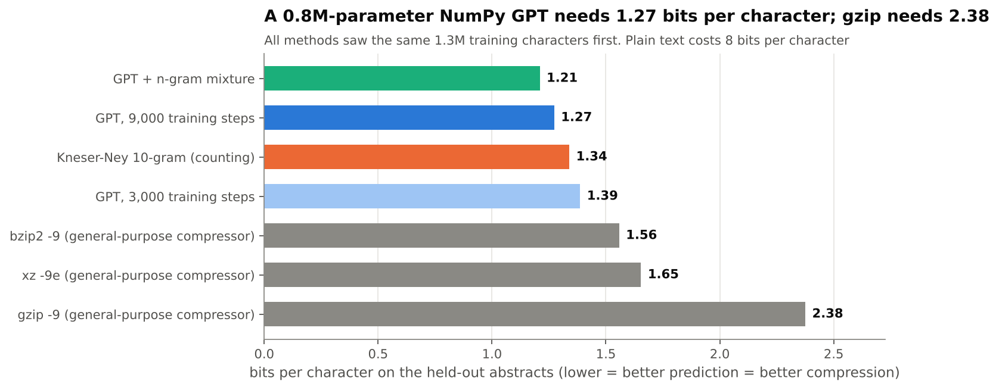</p>

**Contents:** [Why it matters](#why-this-is-worth-doing) · [How it works](#how-it-works) · [What the experiments show](#what-the-experiments-show) · [Use it](#use-it) · [Limitations](#limitations) · [Questions to be ready for](#questions-to-be-ready-for) · [Structure](#project-structure) · [References](#references)

---

## Why this is worth doing

Large language models are trained with one objective: predict the next token. This project builds that whole pipeline at a size where every step can be inspected:

1. the model (embeddings, causal self-attention, MLP, LayerNorm, residual connections);
2. the hand-derived backward pass, which is what PyTorch's autograd hides;
3. the optimiser (AdamW, warm-up and cosine decay, gradient clipping, dropout);
4. honest evaluation, including a strong baseline that is easy to skip and important to include.

Two practical uses fall out of a next-character model. A model that predicts well **compresses** well (Shannon): 1.27 bits per character means an arithmetic coder driven by it would shrink these abstracts to 16% of their size. And a model that predicts the next characters can **autocomplete** them: [`autocomplete.py`](autocomplete.py) is a working tool.

```
$ python autocomplete.py "the heat transfer to a blunt"

  the heat transfer to a blunt|
    blunt  (word already complete)      66.2%
    blunted                             16.2%
    blunt-nosed                          6.9%
    blunt-body                           3.9%
    blunting                             1.8%
```

---

## How it works

### 1. A language model is a compressor

A language model assigns a probability to the next character given the previous ones, P(x_t | x_1 … x_{t−1}). It is trained by minimising the **cross-entropy** on real text:

$$\mathcal{L} = -\frac{1}{N}\sum_{t=1}^{N} \log_2 P(x_t \mid x_{<t})$$

In base 2 this is the number of **bits per character (BPC)** an ideal compressor using the model would need (Shannon, 1948).

- A uniform guess over the 51 characters costs log₂ 51 ≈ 5.67 bits. Every bit below that is structure the model has learned.
- "Perplexity" is the same quantity written as 2^BPC.
- This is exactly the objective large models like GPT-4 or Claude are pre-trained on, only over tokens instead of characters.

### 2. The baseline: counting (Kneser-Ney n-grams)

An n-gram model predicts from the previous n−1 characters only, using counts from the training text. Raw counts give zero probability to anything unseen, so they are **smoothed**. Interpolated Kneser-Ney (Kneser & Ney, 1995; Chen & Goodman, 1998), the best classical method, computes:

$$P_{KN}(w \mid h) = \frac{\max(c(hw) - D,\,0)}{c(h)} + \frac{D \cdot N_{1+}(h\,\bullet)}{c(h)}\; P_{KN}(w \mid h')$$

- It subtracts a small discount D from every observed count and gives the freed probability to the shorter history h′.
- The more *different* characters have been seen after h (N₁₊(h•)), the more the shorter history is trusted.
- The shorter-history models use **continuation counts** instead of raw counts: how many distinct contexts a string appears in. This is Kneser-Ney's key idea. A string that is frequent but only ever appears after one context should not be predicted everywhere.

The implementation uses no Python dictionaries:

- every n-gram is packed into one 64-bit integer (base-51 digits);
- counting is `np.unique` and lookup is `np.searchsorted`;
- as a result, fitting a 10-gram on 1.3 M characters takes about a second.

### 3. The model: a GPT

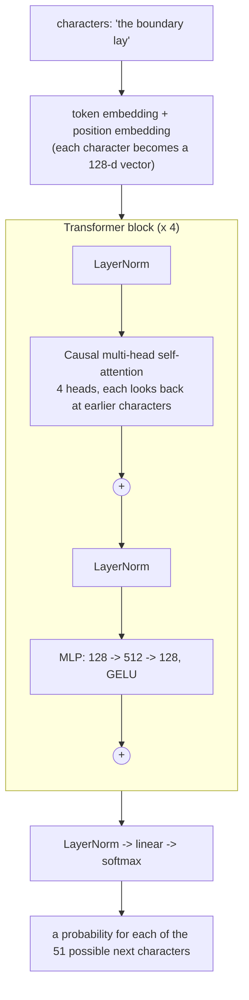

**Self-attention** is the part that makes this a transformer. Each position produces three vectors:

- a *query*: what am I looking for?
- a *key*: what do I contain?
- a *value*: what do I pass on?

Position t gathers information from earlier positions in proportion to how well its query matches their keys:

$$\mathrm{Attention}(Q,K,V) = \mathrm{softmax}\!\left(\frac{QK^\top}{\sqrt{d_k}} + M\right)V, \qquad M_{ij} = \begin{cases}0 & j \le i\\ -\infty & j > i\end{cases}$$

- **Scaling by √d_k.** Dividing by √d_k keeps the dot products at unit scale, so the softmax does not saturate at initialisation.
- **The causal mask M.** It stops a position from peeking at the future it is trying to predict.
- **Multiple heads.** Four independent attention patterns of 32 dimensions each run in parallel, and [the analysis below](#6-the-attention-heads-specialise) shows that they specialise.

The other components are:

- **The MLP.** It is applied to every position separately, and it is where most of the parameters, and much of the "knowledge", live.
- **Residual connections** (x + f(x)). They give gradients a direct path through the depth of the network.
- **Pre-LayerNorm**, as in GPT-2: each sub-layer's input is normalised first, which keeps training stable.
- **GPT-2's initialisation.** It scales the residual projections by 1/√(2·layers) so that the residual stream's variance does not grow with depth.

### 4. Backpropagation by hand

There is no autograd. [`model.py`](src/tinygpt/model.py) caches what each forward operation needs and applies the chain rule in reverse. These are the three derivations worth knowing.

**Softmax + cross-entropy.** With p = softmax(z) and correct class y, the gradient collapses to

$$\frac{\partial \mathcal{L}}{\partial z} = p - \mathbf{1}_y$$

**Attention.** With S = QKᵀ/√d, P = softmax(S) and O = PV:

$$dV = P^\top dO,\quad dP = dO\,V^\top,\quad dS = P \odot \Big(dP - \textstyle\sum_j (dP \odot P)_{\cdot j}\Big),\quad dQ = \tfrac{1}{\sqrt d}\,dS\,K,\quad dK = \tfrac{1}{\sqrt d}\,dS^\top Q$$

The masked entries need no special treatment: their P is exactly 0, so their gradient is 0.

**LayerNorm.** With x̂ = (x − μ)/σ, y = γx̂ + β and g = γ ⊙ dy:

$$dx = \frac{1}{\sigma}\Big(g - \overline{g} - \hat{x}\,\overline{g \odot \hat{x}}\Big)$$

Bars are means over the feature dimension. The two subtracted terms appear because μ and σ depend on every input.

**Proof that the gradients are right.** [`tests/test_gradients.py`](tests/test_gradients.py) builds a small 2-layer version of the same model in float64. It compares 6 random entries of each of its 29 gradient tensors with a central finite difference, (L(θ+ε) − L(θ−ε)) / 2ε:

| Setting | Largest relative error |
|---|---|
| without dropout | **1.4 × 10⁻⁷** |
| with dropout 0.2 (same mask in both passes) | **3.2 × 10⁻⁷** |

A wrong formula typically gives errors between 10⁻² and 1.

### 5. Training

| Choice | Value | Why |
|---|---|---|
| Data | 1,398 abstracts, 1.43 M characters. 10% of *abstracts* (140) held out | Splitting by document means validation text is genuinely unseen |
| Model | 4 layers, 4 heads, width 128, context 128 characters, 0.82 M parameters | About the largest size that trains in reasonable time on a CPU in NumPy |
| Optimiser | AdamW, β = (0.9, 0.99), weight decay 0.1 on weight matrices | Adam gives per-parameter step sizes. Decoupled weight decay (Loshchilov & Hutter) acts as a regulariser |
| Schedule | 9,000 steps: 100-step linear warm-up, then cosine decay from 2e-3 to 1e-4 | Warm-up avoids huge early Adam steps while its moment estimates are still noisy |
| Regularisation | Dropout 0.1 on both residual branches. Gradient clipping at norm 1 | 1.3 M characters is small enough for the model to memorise |
| Batch | 32 random windows × 128 characters | 4,096 predicted characters per step |
| Evaluation | Sliding windows with stride 64 | Every scored character has at least 64 characters of context. Otherwise characters at the start of a window would be scored with almost no context |

Training took 87 minutes on 2 CPU cores.

Speed came from one non-obvious fix. NumPy 2 promotes `float32_array * np.float64_scalar` to float64, so constants such as √(2/π) in GELU and 1/√d in attention silently turned every activation into float64. Two changes cut a training step from 1.6 s to 0.55 s:

- making those constants plain Python floats;
- writing `x*x*x` instead of `x**3`.

---

## What the experiments show

All numbers come from [`results/`](results/) and are produced by [`experiments/analyze.py`](experiments/analyze.py). Every figure is drawn from those files by [`experiments/make_figures.py`](experiments/make_figures.py).

### 1. The transformer only wins once it is trained long enough

<p align="center">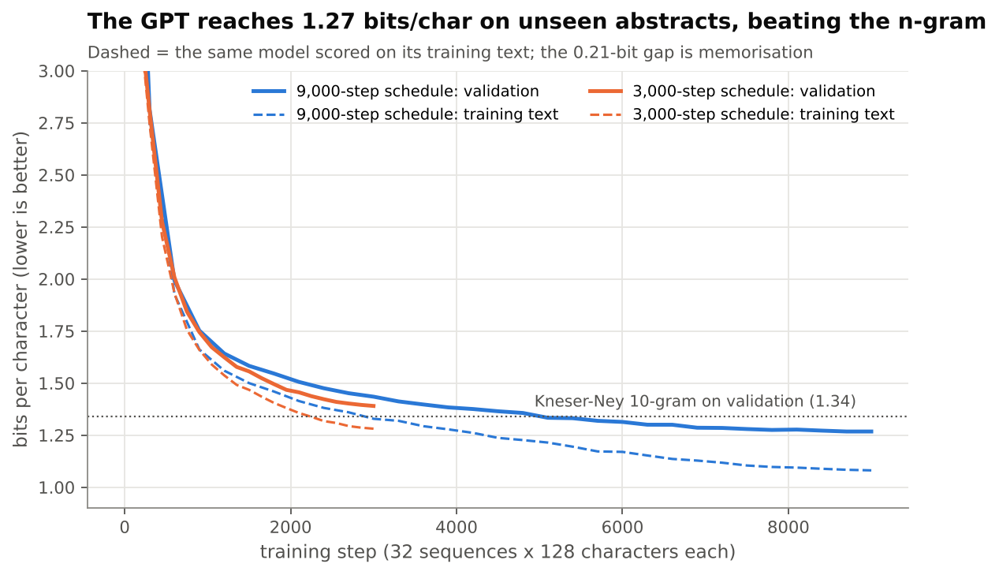</p>

| Model | BPC on unseen abstracts |
|---|---|
| GPT, 9,000-step schedule | **1.273** |
| Kneser-Ney 10-gram | 1.339 |
| GPT, same model on a 3,000-step schedule | 1.387 |

The 3,000-step run is the same model and data with a third of the compute, and it **loses to counting**. The 9,000-step run beats it.

- **Why it matters:** an under-trained neural model losing to a well-smoothed n-gram is common. Without the baseline, the 3,000-step model would have looked like a success.
- **Memorisation:** the dashed lines are the same model scored on its own training text. The final gap is 0.21 bits, and it widens as training goes on.
- **How the checkpoint was chosen:** the saved checkpoint is the one with the best validation score (step 8,700). Validation was still improving slowly at the end.

**Is the gap between the GPT and the n-gram real?** Characters inside one abstract are not independent, so the uncertainty comes from a bootstrap that resamples whole abstracts (2,000 resamples of the 140 validation abstracts):

- the GPT is better by **0.066 bits per character, 95% interval [0.056, 0.076]**;
- it wins on **84% of the abstracts** (118 of 140).

The interval is far from zero, so the gap is not luck in which abstracts were held out.

### 2. Counting memorises instead of generalising

<p align="center">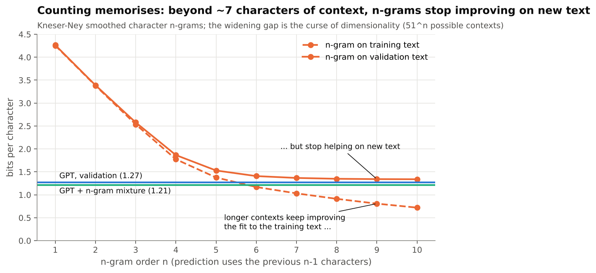</p>

On the training text, every extra character of context helps the n-gram: 0.72 BPC at order 10. On new text the curve flattens after about 7 characters of context (1.368 → 1.349 → 1.342 → 1.339). This is the **curse of dimensionality** in its plainest form:

- there are 51ⁿ possible contexts;
- the training text contains 514,407 distinct 10-grams in 1.29 M positions, so most long contexts are seen once or never;
- a counting model can only share statistics between *identical* strings.

A neural model maps similar contexts to similar vectors, so evidence carries over between them. That is the whole argument for neural language models (Bengio et al., 2003).

### 3. Bigger is better, with diminishing returns

<p align="center">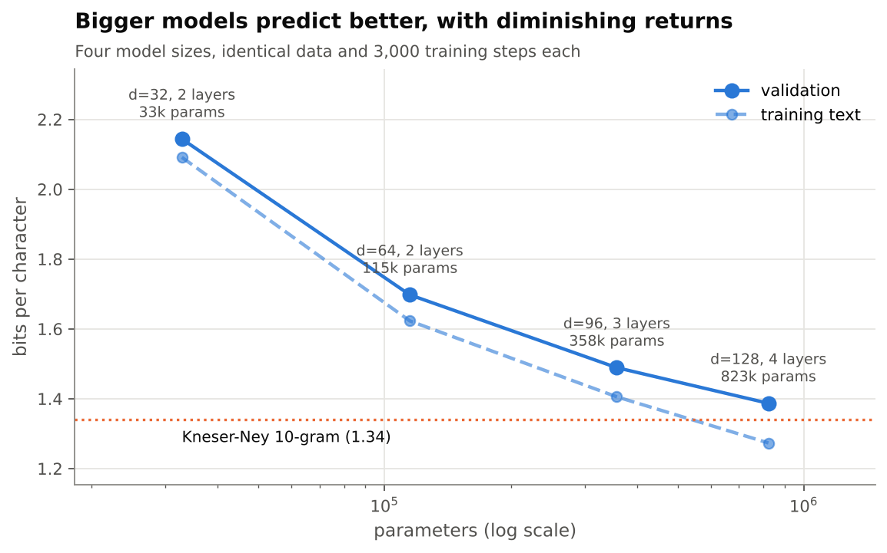</p>

Four sizes were trained on identical data for the same 3,000 steps:

| Width × layers | Parameters | Validation BPC | Train − validation gap |
|---|---|---|---|
| 32 × 2 | 33 k | 2.144 | 0.05 |
| 64 × 2 | 115 k | 1.698 | 0.07 |
| 96 × 3 | 358 k | 1.489 | 0.08 |
| 128 × 4 | 823 k | 1.387 | 0.11 |

- **Every increase in size helps,** but each doubling of parameters buys less: 0.25 bits per doubling between the two smallest models, 0.13 in the middle, and 0.085 at the top. Even on a log scale the curve bends. This is the small-scale version of the "scaling laws" picture (Kaplan et al., 2020), in which loss falls as a power law in model size until data or compute becomes the limit.
- **The gap between training and validation text grows with size** (0.05 → 0.11 bits). Bigger models memorise more of 1.3 M characters, which is why dropout was needed.
- **On this budget none of the sizes beats the n-gram.** Section 1 showed that compute, not size, was the missing piece for the largest model.

### 4. The GPT's advantage comes from long context

<p align="center">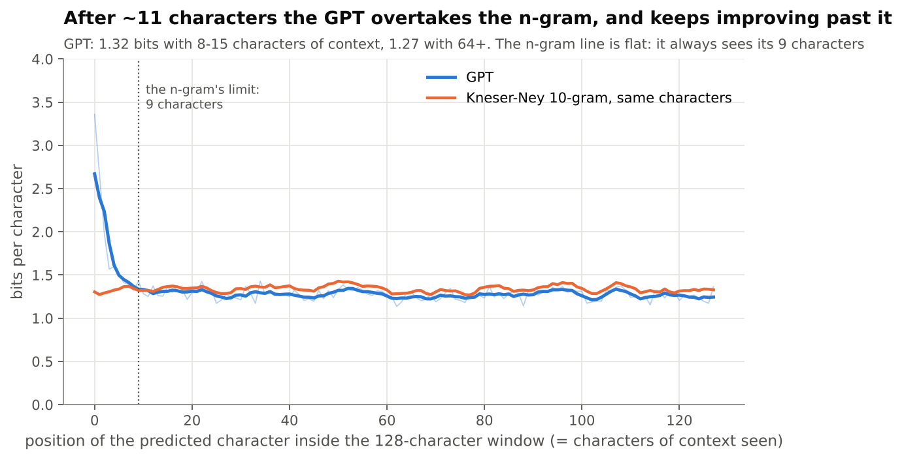</p>

**How this was measured.** The validation text is cut into non-overlapping 128-character windows. Loss is then measured by position inside the window: the character at position p has only p characters of context. The n-gram is scored on exactly the same characters, but it always sees its 9 preceding characters, so its line is flat.

**What it shows:**

| Context the GPT has seen | GPT BPC |
|---|---|
| none (first character of a window) | 3.36 |
| 8–15 characters | 1.32 |
| 64 or more characters | 1.27 |

- The GPT overtakes the n-gram at around 11 characters of context.
- It **keeps improving beyond the n-gram's limit**: its lead over the n-gram grows from 0.01 bits (8–15 characters of context) to about 0.07 bits (32 characters or more).

This is direct evidence that attention reads information from further back than any fixed-order model can. One practical consequence: a "context length" is only useful if the model has learned to use it, and this curve is how you check.

### 5. Where the remaining uncertainty is

<p align="center">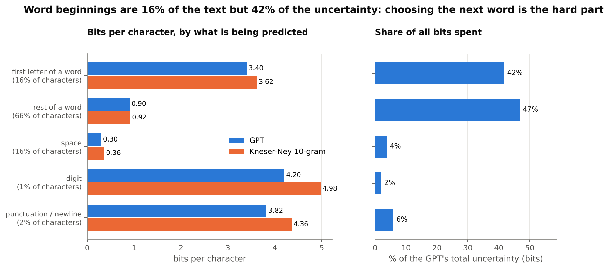</p>

Every validation character was classified by what is being predicted:

- **The first letter of a word** is 16% of the text but **42% of all the bits** (3.40 bits each).
- **The rest of a word** costs only 0.90 bits per character: once a word has started, spelling is nearly deterministic.

So the hard part of language modelling is *choosing the next word*, not spelling it. This is also why word- and sub-word-level models (BPE tokens) are more efficient: they spend their capacity on the choice, not on spelling.

The GPT beats the n-gram in every class, and the margin is largest where long-range context helps:

| Class | GPT | n-gram |
|---|---|---|
| digits | 4.20 | 4.98 |
| punctuation | 3.82 | 4.36 |
| first letters | 3.40 | 3.62 |
| rest of a word | 0.90 | 0.92 |

The GPT does *not* win everywhere character by character: it gives the correct character a higher probability than the n-gram only **52%** of the time. Its advantage is an average of many small, two-sided differences. That is exactly why mixing the two models helps ([section 8](#8-two-different-models-are-better-than-one)).

### 5b. The edge is not on strings the model has never seen

<p align="center">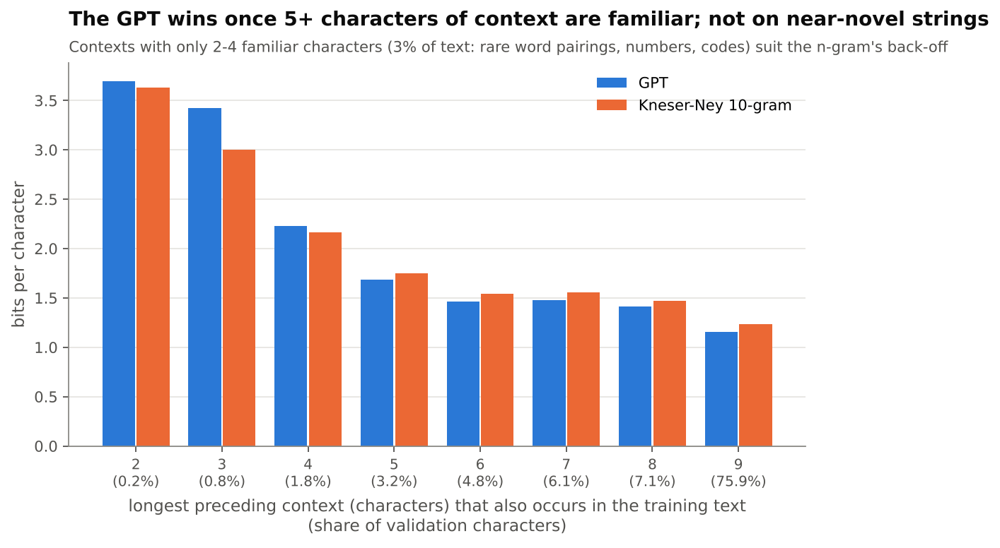</p>

**How this was measured.** For every validation character, I found the longest preceding context that also occurs somewhere in the training text.

- **When 5 or more characters of context are familiar** (97% of the text), the GPT is better.
- **When only 2–4 characters are familiar** (3% of the text: rare word pairings, numbers, report codes), the n-gram's back-off is as good or better.

This contradicts the easy story that "the neural model generalises to unseen contexts". The GPT's advantage is in *familiar* territory, where it combines evidence from further back than the n-gram can look.

### 6. The attention heads specialise

<p align="center">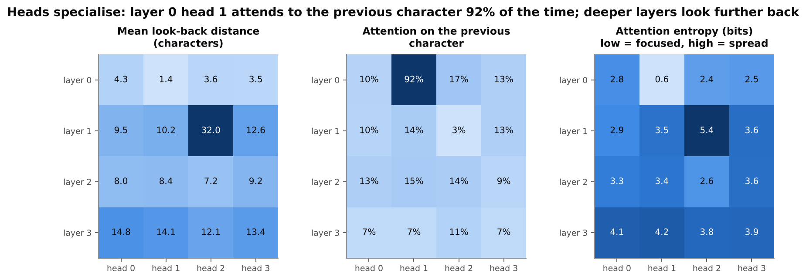</p>
<p align="center">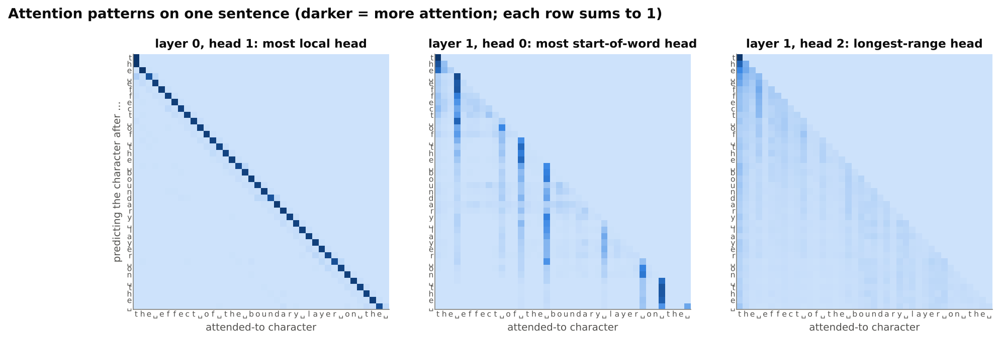</p>

Attention statistics were averaged over 96 random validation windows, using query positions with at least 32 characters of history:

- **Layer 0, head 1 is a "previous character" head.** 92% of its attention goes to the character immediately before. Its entropy is 0.6 bits, so it is almost a hard pointer. The model built a bigram feature for itself.
- **Layer 1, head 0 is a "start of the current word" head.** In the example sentence its attention jumps to the space before each word and stays there until the word ends (the vertical stripes). Knowing where the word began is what you need to predict how it ends.
- **Layer 1, head 2 is a long-range "averaging" head.** It looks back 32 characters on average and has 5.4 bits of entropy, so its attention is spread very widely. It summarises the topic rather than the position.
- **Layers 2 and 3** spread their attention over the last 7–15 characters: roughly the current and previous words.

Caveat: attention weights show *where* information is read from, not what is done with it. These labels are descriptions, not proofs of mechanism.

### 7. Temperature trades correctness for variety

<p align="center">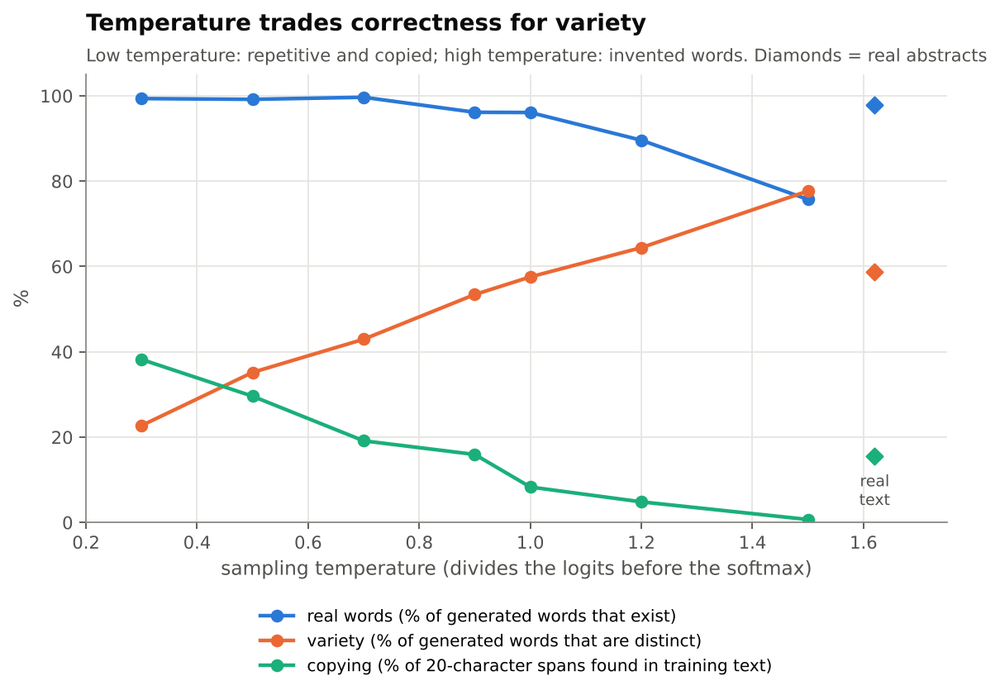</p>

**How this was measured.** Twelve 400-character samples were generated at each temperature. Three statistics were compared with real abstracts:

- the share of generated words (3+ letters) that exist in the training text;
- the share that are distinct;
- the share of 20-character spans copied verbatim from the training text.

| Temperature | Real words | Distinct | Copied spans |
|---|---|---|---|
| 0.3 | 99% | 23% | 38% |
| 1.0 | 96% | 58% | 8% |
| 1.5 | 76% | 78% | 1% |
| *real abstracts* | 98% | 59% | 16% |

- **At low temperature** the text is correct but repetitive and largely copied.
- **At high temperature** it invents words.
- **At T = 1** the variety matches real text almost exactly. This is what cross-entropy training should produce: the loss is minimised by *calibrated* probabilities, so sampling at T = 1 reproduces the training distribution's statistics. It is also why chatbots sample at T < 1: they trade variety for fewer errors.

**Evidence against memorisation.** At the same temperature (1.0), the n-gram copies **18%** of 20-character spans from the training text and the GPT only **8%**, fewer than real abstracts do (16%).

Samples (prompt: *"the boundary layer"*):

> **T = 0.3:** the boundary layer on a flat plate with a supersonic stream . the present paper is a function of the approximation of the approximate solution of the shock wave in the laminar boundary layer . the effect of the pressure distribution on a flat plate is described …
>
> **T = 0.7:** the boundary layer on random reynolds number . the measurements of parameters of applicable three-dimensional bodies of revolution and lower cones and a cross-section that of the shape of the circulation subject to the total and the solution of the boundary layer …
>
> **T = 1.0:** the boundary layer, some approximations are derived and the explorated motion of gust nonlinear equations . the large case has been closely the integral equations to the primary differential equations …

The grammar is local and the meaning drifts: about what you would expect from 0.8 M parameters trained on 1.3 M characters.

### 8. Two different models are better than one

The models make different errors, so their probabilities can be averaged:

$$p = \lambda\, p_{GPT} + (1-\lambda)\, p_{KN}$$

- **How λ is chosen.** It is cross-fitted: tuned on one half of the validation text and scored on the other, then the other way round. The reported number is therefore never tuned on the text it is scored on.
- **Result.** λ ≈ 0.6 and **1.210 BPC**, which is 0.063 bits better than the GPT alone (95% interval [0.059, 0.069]). The mixture beats the GPT on 139 of the 140 abstracts.

Why mixing helps is Jensen's inequality: −log of an average is at most the average of the −logs. A mixture can never be worse than the λ-weighted average of the two losses, and it gains most exactly where the models disagree. Speech recognisers interpolated language models this way for decades, and kNN-LM (Khandelwal et al., 2020) mixes a transformer with a nearest-neighbour memory using the same formula.

### 9. As a tool: autocomplete for technical writing

<p align="center">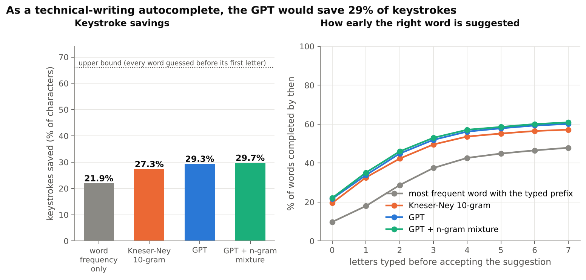</p>

**How this was measured.** A simulated typist types 2,013 words of held-out abstracts. Before each keystroke, the system proposes the rest of the current word. If the proposal is exactly right, the typist presses Tab, costing one keystroke instead of the remaining letters.

| Method | Keystrokes saved | Words completed early |
|---|---|---|
| most frequent training word with the typed prefix | 21.9% | 49% |
| Kneser-Ney 10-gram | 27.3% | 58% |
| **GPT** | **29.3%** | **61%** |
| GPT + n-gram mixture | 29.7% | 62% |

The upper bound, if every word were guessed before its first letter, is 66%. The GPT completes 22% of words before a single letter is typed. The improvement in BPC turns into a measurable saving for a user.

---

## Use it

```bash
git clone https://github.com/aanandajith275-byte/numpy-gpt-from-scratch
cd numpy-gpt-from-scratch
pip install -r requirements.txt          # numpy, pandas, matplotlib: nothing else

python autocomplete.py "the flow over a swept w"           # suggest the rest of the word
python autocomplete.py                                     # interactive mode
python generate.py "a method is presented for"             # write abstract-style text
python generate.py --temperature 0.4 --chars 400 "the boundary layer"
```

The trained model (`checkpoints/main_long.npz`, 3 MB) is included, so these commands run in about a second.

To reproduce everything from scratch (a laptop CPU is enough):

```bash
python tests/test_gradients.py                                               # ~1 min: check every gradient
python experiments/train.py --name main_long --steps 9000 --eval_every 300   # ~1.5 h: the headline model
python experiments/train.py --name main --steps 3000                         # ~30 min: the short schedule
python experiments/train.py --name size_32x2 --n_embd 32 --n_layer 2 --steps 3000
python experiments/train.py --name size_64x2 --n_embd 64 --n_layer 2 --steps 3000
python experiments/train.py --name size_96x3 --n_embd 96 --n_layer 3 --steps 3000
python experiments/analyze.py            # ~10 min: every number in this README -> results/
python experiments/make_figures.py       # every figure -> figures/
```

Everything is seeded, so reruns give the same numbers up to floating-point differences between machines.

---

## Limitations

- **Small and old corpus.** The corpus is 1.43 M characters of 1950s–60s aerospace abstracts. The absolute numbers are specific to this text. What carries over is the *comparisons*: transformer vs counting, short vs long training, and which characters are hard.
- **Characters, not tokens.** Real LLMs use sub-word tokens. Section 5 shows why: most of a character model's capacity goes on spelling out words it has already chosen.
- **One training seed per model size.** The bootstrap covers uncertainty from *which abstracts* were held out. It does not cover run-to-run variation in training. The size sweep's smooth trend suggests that variation is small compared with the effects reported, but that was not measured.
- **The compression comparison ignores model size.** gzip's "model" is a few kilobytes of code. Ours is 3 MB of weights, larger than the 0.14 MB validation text, so as a practical compressor for this file the GPT would lose. The comparison is about *prediction quality*, which is what BPC measures.
- **The autocomplete simulation is idealised.** It assumes a typist who always notices a correct suggestion and sees only one suggestion at a time. Real keystroke savings would be lower.
- **Attention ≠ explanation.** The head analysis is descriptive (section 6).

---

## Questions to be ready for

<details><summary><b>Why bits per character and not accuracy?</b></summary>

Accuracy only checks the top guess. Cross-entropy scores the whole probability distribution and is what the model is trained on. In base 2 it has a physical meaning: the size of the compressed text. It is also directly comparable with gzip and with the n-gram, which have no "accuracy".
</details>

<details><summary><b>Why divide by √d_k in attention?</b></summary>

If q and k have independent unit-variance components, q·k has variance d_k. Without the scaling, logits of size ~√d_k push the softmax into a near one-hot regime where its gradients vanish.
</details>

<details><summary><b>Why did the 3,000-step model lose to the n-gram?</b></summary>

It was still improving. Its validation loss was falling at the last step, so it was under-trained rather than too small: the same architecture beats the n-gram at 9,000 steps. A Kneser-Ney model is "trained" exactly in one pass over the counts. A neural model needs enough optimisation to get there.
</details>

<details><summary><b>Why does the n-gram stop improving at about 8 characters?</b></summary>

Data sparsity. The number of possible contexts grows as 51ⁿ, and the 10-gram table already holds 514 k distinct entries for 1.29 M positions. Most long contexts in new text were never seen, so the model backs off to shorter ones. Train BPC keeps falling (memorisation) while validation BPC flattens.
</details>

<details><summary><b>How do you know the backward pass is right?</b></summary>

It is compared against central finite differences in float64 for every parameter tensor, with and without dropout, and the largest relative error is 3 × 10⁻⁷. Float64 matters: in float32 the rounding error of the finite difference itself would be large enough to hide real bugs.
</details>

<details><summary><b>Why does sampling at T = 1 reproduce the statistics of real text?</b></summary>

Cross-entropy is a proper scoring rule: it is minimised by the true distribution, so a well-trained model is calibrated, and sampling from it at T = 1 imitates the data. Temperature T rescales the logits to z/T. T < 1 sharpens the distribution (safer, more repetitive) and T > 1 flattens it (more varied, more errors).
</details>

<details><summary><b>Why does mixing two models help, and why cross-fit λ?</b></summary>

By convexity (Jensen), −log(λp₁ + (1−λ)p₂) ≤ −λ log p₁ − (1−λ) log p₂. The gain is largest where the models disagree. λ is tuned on one half of the validation text and evaluated on the other. Otherwise the reported number would be optimistically biased by the tuning.
</details>

<details><summary><b>Why split train/validation by abstract rather than by character position?</b></summary>

Text from the same abstract repeats phrases, symbols and topic words. A random character-level split would put near-copies of validation text in training and overstate generalisation.
</details>

<details><summary><b>Why pre-LayerNorm instead of the original post-LayerNorm?</b></summary>

With the norm inside the residual branch, the residual path from the output to the input is an identity, so gradients reach early layers undiminished. Post-LN transformers usually need careful learning-rate warm-up to train at all (Xiong et al., 2020).
</details>

<details><summary><b>What would you change with a GPU and more data?</b></summary>

Use BPE tokens instead of characters (section 5 shows the waste), train much longer (the loss was still falling), and run multiple seeds. I would also test whether the head roles in section 6 persist.
</details>

---

## Project structure

```
numpy-gpt-from-scratch/
├── src/tinygpt/
│   ├── model.py        # the GPT: forward pass, hand-written backward pass, AdamW, sampling
│   ├── ngram.py        # interpolated Kneser-Ney character n-gram model (the baseline)
│   ├── data.py         # character vocabulary, train/validation split by abstract, batching
│   └── evaluate.py     # bits per character with sliding windows
├── tests/
│   └── test_gradients.py   # finite-difference check of all 29 gradient tensors
├── experiments/
│   ├── train.py        # training loop (warm-up + cosine schedule, dropout, clipping, checkpointing)
│   ├── analyze.py      # every experiment in this README
│   ├── make_figures.py # every figure
│   └── style.py
├── autocomplete.py     # word completion (beam search over characters)
├── generate.py         # text generation from a prompt
├── checkpoints/main_long.npz   # the trained model
├── data/               # the corpus and where it comes from
├── results/            # every number, as csv / json
└── figures/
```

## References

- Shannon, C. (1948). A mathematical theory of communication. *Bell System Technical Journal.*
- Kneser, R. & Ney, H. (1995). Improved backing-off for m-gram language modeling. *ICASSP.*
- Chen, S. & Goodman, J. (1998). An empirical study of smoothing techniques for language modeling. *Harvard TR-10-98.*
- Bengio, Y. et al. (2003). A neural probabilistic language model. *JMLR.*
- Vaswani, A. et al. (2017). Attention is all you need. *NeurIPS.*
- Radford, A. et al. (2019). Language models are unsupervised multitask learners (GPT-2). *OpenAI.*
- Ba, J., Kiros, J. & Hinton, G. (2016). Layer normalization. *arXiv:1607.06450.*
- Hendrycks, D. & Gimpel, K. (2016). Gaussian error linear units (GELUs). *arXiv:1606.08415.*
- Loshchilov, I. & Hutter, F. (2019). Decoupled weight decay regularization. *ICLR.*
- Xiong, R. et al. (2020). On layer normalization in the transformer architecture. *ICML.*
- Khandelwal, U. et al. (2020). Generalization through memorization: nearest neighbor language models. *ICLR.*
- Holtzman, A. et al. (2020). The curious case of neural text degeneration. *ICLR.*
- Kaplan, J. et al. (2020). Scaling laws for neural language models. *arXiv:2001.08361.*
- Karpathy, A. *nanoGPT* / *minGPT*: the reference PyTorch implementations this architecture follows.
- Cleverdon, C. (1967). The Cranfield tests on index language devices. *Aslib Proceedings.* (Source of the abstracts.)

## License

MIT. See [LICENSE](LICENSE). The Cranfield abstracts are a long-standing public research collection; see [data/README.md](data/README.md).
